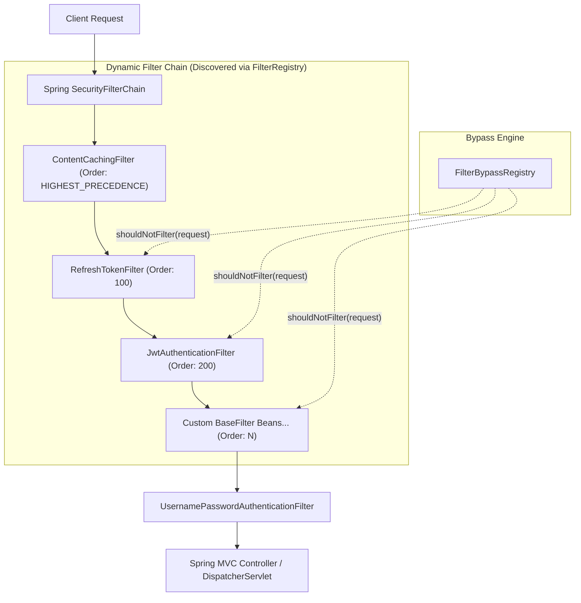
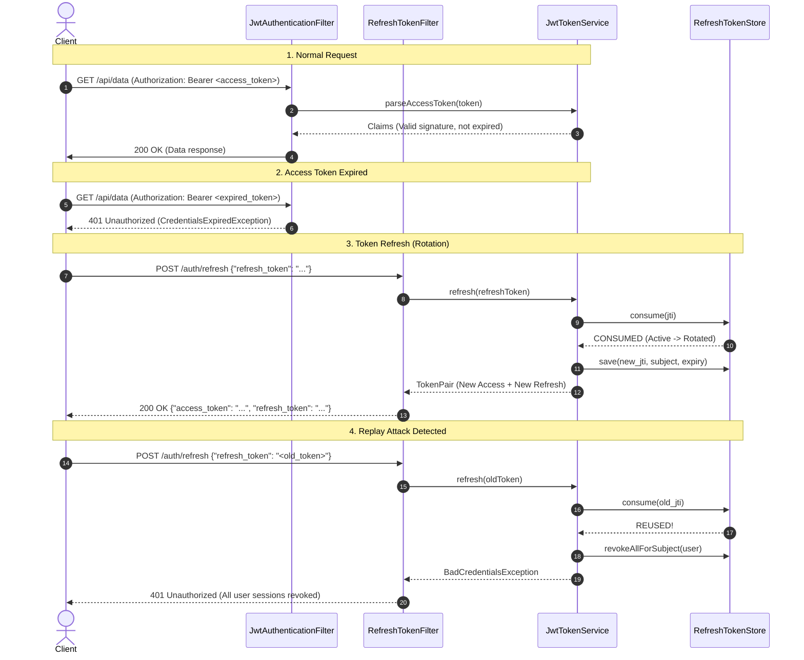
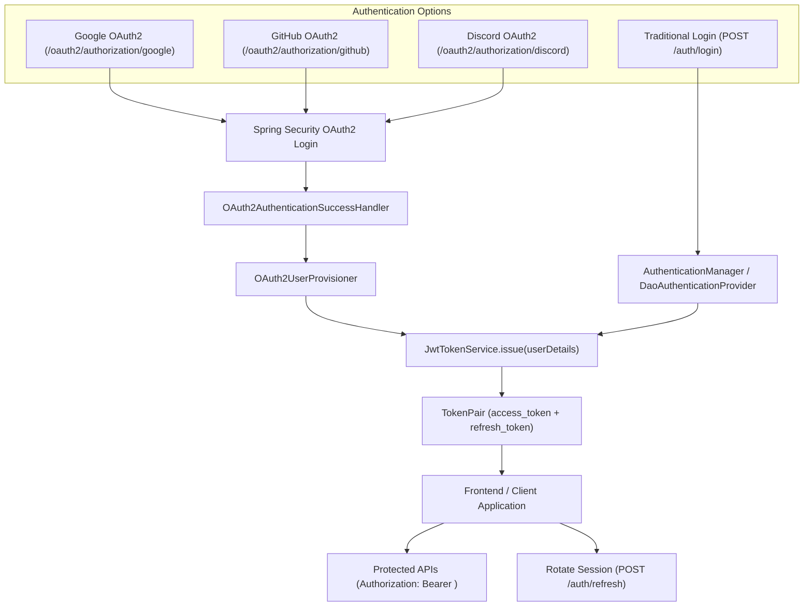

# Spring Security Architecture & Usage

**Summary**: Explains the dynamic filter chain security architecture, FilterRegistry, BaseFilter contract, endpoint bypass mechanisms, and RFC-compliant JWT with single-use refresh token rotation.  
**Sources**: `surtek-security/` codebase  
**Last updated**: 2026-10-14  

---

## Architecture Overview

Surtek Security implements a **dynamic filter chain architecture** in Spring Security. Rather than declaring static filter chains inside `HttpSecurity`, custom security filters extending `BaseFilter` are automatically discovered from Spring's application context, ordered by precedence, and injected into the security chain.



### Core Design Principles

1. **Dynamic Filter Pipeline**: Any Spring component extending `BaseFilter` is automatically registered into the filter chain in the order specified by `@Order`.
2. **Single Extension Point (`onFilterChain`)**: Filter authors only implement `onFilterChain`. Common infrastructure like WebSocket upgrade skips, path-level exemption checks, error resolution, and downstream chain tracking are sealed within `BaseFilter`.
3. **Type-Safe Dynamic Bypass**: Endpoints can exempt themselves from specific filters using filter class references via `@BypassFilter`.
4. **RFC-Compliant & Secure JWT**: Separate HMAC keys for access and refresh tokens, `token_use` claim checks, single-use refresh token rotation, and replay detection (revoking all sessions if an already-used refresh token is submitted).

---

## Core Components

### 1. `BaseFilter`
Located in `com.sabarceria.surtek.filter.BaseFilter`. Every security filter extends this class.

- **Exposed Contract**:
  ```java
  protected abstract void onFilterChain(HttpServletRequest request, HttpServletResponse response, FilterChain chain)
          throws ServletException, IOException;
  ```
- **Sealed Responsibilities (`final`)**:
  - `shouldNotFilter`: Automatically skips WebSocket upgrades (`Upgrade: websocket`) and queries `FilterBypassRegistry` to check if the route is exempted from this filter type.
  - `doFilterInternal`: Wraps downstream calls with a tracking filter chain. If a filter throws an exception before calling `chain.doFilter`, the exception is delegated to `HandlerExceptionResolver` (`@ControllerAdvice`) or mapped to standard HTTP statuses (401, 403, etc.).

### 2. `FilterRegistry`
Located in `com.sabarceria.surtek.filter.FilterRegistry`.
- Discovers all beans extending `BaseFilter` via Spring's `ObjectProvider<BaseFilter>`.
- Automatically sorts filters based on Spring's `@Order` annotation (lower value runs earlier).
- Logs the resolved execution chain at startup:
  ```text
  Security filter chain: [RefreshTokenFilter -> JwtAuthenticationFilter -> CustomFilter]
  ```

### 3. `SecurityConfig`
Located in `com.sabarceria.surtek.config.SecurityConfig`.
- Configures a stateless, CORS-enabled, CSRF-disabled `SecurityFilterChain`.
- Dynamically attaches each filter from `FilterRegistry` before `UsernamePasswordAuthenticationFilter`:
  ```java
  for (BaseFilter filter : filterRegistry.getFilters()) {
      http.addFilterBefore(filter, UsernamePasswordAuthenticationFilter.class);
  }
  ```

### 4. `FilterBypassRegistry`
Located in `com.sabarceria.surtek.filter.FilterBypassRegistry`.
- Scans all controller beans marked with `@EnableByPassSecurity`.
- Inspects route annotations (`@RequestMapping`, `@GetMapping`, `@PostMapping`, etc.) combined with `@BypassFilter`:
  - `@BypassFilter`: Bypasses explicitly specified filter classes (e.g., `JwtAuthenticationFilter.class`, or all filters when no specific filter class is given).
- Maintains runtime `AntPathRequestMatcher` mappings per filter class.

### 5. JWT Infrastructure (`com.sabarceria.surtek.jwt`)



- **`JwtProperties`**: Strongly-typed configuration (`surtek.security.jwt.*`).
- **`TokenPair`**: Record containing `access_token`, `refresh_token`, `token_type`, `expires_in`, `refresh_expires_in`.
- **`RefreshTokenStore`**: Interface for stateful refresh token tracking. Includes default `InMemoryRefreshTokenStore` with atomic single-use rotation and revocation. Replaceable with Redis in distributed deployments.
- **`JwtTokenService`**: Handles issuing, cryptographic parsing, rotation, and revocation.
- **`RefreshTokenFilter`**: Endpoint filter running at `Order(100)` handling `POST /auth/refresh`.
- **`JwtAuthenticationFilter`**: Authenticating filter running at `Order(200)` validating `Authorization: Bearer <token>`.

---

## Configuration

Add the JWT configuration to `application.yml` or `application.properties`:

```yaml
surtek:
  security:
    jwt:
      issuer: surtek-api
      # Generate base64 keys of at least 32 bytes (256-bit):
      # openssl rand -base64 32
      access-token-secret: YWNjZXNzLXNlY3JldC1rZXktMzItYnl0ZXMtbG9uZyE=
      refresh-token-secret: cmVmcmVzaC1zZWNyZXQta2V5LTMyLWJ5dGVzLWxvbmc=
      access-token-ttl: 15m
      refresh-token-ttl: 7d
      clock-skew: 30s
      refresh-path: /auth/refresh
```

---

## Developer Usage Guide

### 1. Creating a Custom Security Filter
Extend `BaseFilter`, add `@Component`, and set its execution order with `@Order`:

```java
package com.sabarceria.surtek.filter;

import org.springframework.core.annotation.Order;
import org.springframework.stereotype.Component;

import javax.servlet.FilterChain;
import javax.servlet.ServletException;
import javax.servlet.http.HttpServletRequest;
import javax.servlet.http.HttpServletResponse;
import java.io.IOException;

@Component
@Order(300) // Runs after JwtAuthenticationFilter (200)
public class CustomTenantValidationFilter extends BaseFilter {

    @Override
    protected void onFilterChain(HttpServletRequest request, 
                                 HttpServletResponse response, 
                                 FilterChain chain) throws ServletException, IOException {
        String tenantId = request.getHeader("X-Tenant-ID");
        
        if (tenantId == null || tenantId.isBlank()) {
            throw new IllegalArgumentException("Header X-Tenant-ID is required");
        }
        
        chain.doFilter(request, response);
    }
}
```

### 2. Exempting / Whitelisting Endpoints
Annotate the controller with `@EnableByPassSecurity` and use `@BypassFilter`:

```java
package com.sabarceria.surtek.controller;

import com.sabarceria.surtek.filter.JwtAuthenticationFilter;
import com.sabarceria.surtek.filter.CustomTenantValidationFilter;
import com.sabarceria.surtek.model.annotation.BypassFilter;
import com.sabarceria.surtek.model.annotation.EnableByPassSecurity;
import org.springframework.web.bind.annotation.*;

@RestController
@EnableByPassSecurity
@RequestMapping("/api")
public class SampleController {

    // 1. Completely bypass JWT Authentication (Public endpoint)
    @GetMapping("/public/info")
    @BypassFilter(JwtAuthenticationFilter.class)
    public String getPublicInfo() {
        return "Public Data";
    }

    // 2. Bypass a specific custom filter
    @GetMapping("/internal/ping")
    @BypassFilter(CustomTenantValidationFilter.class)
    public String ping() {
        return "Pong";
    }

    // 3. Bypass multiple filters dynamically
    @PostMapping("/webhook")
    @BypassFilter({JwtAuthenticationFilter.class, CustomTenantValidationFilter.class})
    public String handleWebhook() {
        return "Webhook received";
    }

    // 4. Fully protected endpoint (requires valid Bearer access token)
    @GetMapping("/secure/data")
    public String getSecureData() {
        return "Sensitive information";
    }
}
```

### 3. Authenticating Users & Generating Tokens
Use `JwtTokenService` in the authentication controller/service:

```java
package com.sabarceria.surtek.controller;

import com.sabarceria.surtek.filter.JwtAuthenticationFilter;
import com.sabarceria.surtek.jwt.JwtTokenService;
import com.sabarceria.surtek.jwt.TokenPair;
import com.sabarceria.surtek.model.annotation.BypassFilter;
import com.sabarceria.surtek.model.annotation.EnableByPassSecurity;
import lombok.RequiredArgsConstructor;
import org.springframework.security.authentication.AuthenticationManager;
import org.springframework.security.authentication.UsernamePasswordAuthenticationToken;
import org.springframework.security.core.Authentication;
import org.springframework.security.core.userdetails.UserDetails;
import org.springframework.web.bind.annotation.*;

@RestController
@EnableByPassSecurity
@RequestMapping("/auth")
@RequiredArgsConstructor
public class AuthController {

    private final AuthenticationManager authenticationManager;
    private final JwtTokenService jwtTokenService;

    @PostMapping("/login")
    @BypassFilter(JwtAuthenticationFilter.class) // Public endpoint
    public TokenPair login(@RequestBody LoginRequest request) {
        Authentication auth = authenticationManager.authenticate(
                new UsernamePasswordAuthenticationToken(request.getUsername(), request.getPassword())
        );
        UserDetails user = (UserDetails) auth.getPrincipal();
        
        return jwtTokenService.issue(user);
    }

    @PostMapping("/logout")
    public void logout(@RequestHeader("Refresh-Token") String refreshToken) {
        jwtTokenService.revoke(refreshToken);
    }

    @PostMapping("/logout-all")
    public void logoutEverywhere(@RequestParam String username) {
        jwtTokenService.revokeAll(username);
    }
}
```

### 4. Refreshing Tokens
Clients call `POST /auth/refresh`:

**Request:**
```http
POST /auth/refresh HTTP/1.1
Host: localhost:8080
Content-Type: application/json

{
  "refresh_token": "eyJhbGciOiJIUzI1NiIsInR5cCI6IkpXVCJ9..."
}
```

**Response (200 OK):**
```json
{
  "access_token": "eyJhbGciOiJIUzI1NiIsInR5cCI6IkpXVCJ9...",
  "refresh_token": "eyJhbGciOiJIUzI1NiIsInR5cCI6IkpXVCJ9...",
  "token_type": "Bearer",
  "expires_in": 900,
  "refresh_expires_in": 604800
}
```

### 5. Production Distributed Token Store (Redis)
Provide a `RefreshTokenStore` bean to override the in-memory fallback:

```java
@Configuration
public class SecurityStoreConfig {

    @Bean
    public RefreshTokenStore redisRefreshTokenStore(StringRedisTemplate redisTemplate) {
        return new RedisRefreshTokenStore(redisTemplate);
    }
}
```

---

## OAuth2 Integration Combined with JWT Refresh Tokens

`surtek-security` supports federated sign-in with **Google**, **GitHub**, and **Discord** alongside traditional, non-OAuth authentication (e.g. username/password). Both paths yield the identical RFC-compliant `TokenPair` issued by `JwtTokenService` and use the same `/auth/refresh` rotation endpoint.



### 1. Dual Authentication: OAuth vs Non-OAuth

- **Non-OAuth Signing (Traditional Login)**:
  - Public endpoint annotated with `@BypassFilter(JwtAuthenticationFilter.class)`.
  - Authenticates via `AuthenticationManager` / `DaoAuthenticationProvider`.
  - Mints `TokenPair` with `jwtTokenService.issue(userDetails)`.
- **OAuth2 Signing (Google, GitHub, Discord)**:
  - User visits `/oauth2/authorization/{provider}` (`google`, `github`, or `discord`).
  - Browser goes through OAuth consent, redirects back to `/login/oauth2/code/{provider}`.
  - `OAuth2AuthenticationSuccessHandler` extracts normalized attributes via `OAuth2UserInfoFactory`.
  - User is loaded or provisioned via `OAuth2UserProvisioner` (default: `DefaultOAuth2UserProvisioner`).
  - Mints the exact same `TokenPair` using `jwtTokenService.issue(userDetails)`.
  - Delivers tokens via frontend redirect (`?access_token=...&refresh_token=...`) or direct JSON response.
- **Unified Token Refresh**:
  - Regardless of whether the user logged in via Google, GitHub, Discord, or password, `POST /auth/refresh` rotates the session identically.

### 2. Stateless OAuth2 Request Storage
Because APIs use `SessionCreationPolicy.STATELESS`, the authorization request state and target redirect URI are held in short-lived HTTP cookies (`HttpCookieOAuth2AuthorizationRequestRepository`), avoiding server-side sessions.

### 3. Configuration (`application.yml`)

```yaml
spring:
  security:
    oauth2:
      client:
        registration:
          google:
            client-id: ${GOOGLE_CLIENT_ID}
            client-secret: ${GOOGLE_CLIENT_SECRET}
            scope: openid, profile, email
          github:
            client-id: ${GITHUB_CLIENT_ID}
            client-secret: ${GITHUB_CLIENT_SECRET}
            scope: read:user, user:email
          discord:
            client-id: ${DISCORD_CLIENT_ID}
            client-secret: ${DISCORD_CLIENT_SECRET}
            scope: identify, email

surtek:
  security:
    oauth2:
      redirect-uri: http://localhost:3000/oauth2/callback # Target frontend redirect URL
      authorized-redirect-uris:
        - http://localhost:3000/oauth2/callback
```

> [!NOTE]
> Discord OAuth2 provider endpoints (`/oauth2/authorize`, `/api/oauth2/token`, `/api/users/@me`) are automatically wired by `OAuth2Configuration` when `discord` is declared under `registration`, eliminating repetitive endpoint configurations.

---

## Related pages

- [[patterns/security/oauth-token-preparation]]
- [[index]]
- [[tasks/backlog]]


