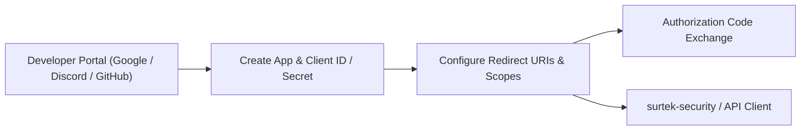

# OAuth Token Preparation (Google, Discord, GitHub)

**Summary**: Step-by-step operational guide for creating OAuth2 developer applications, configuring credentials and redirect URIs, and generating/exchanging tokens for Google, Discord, and GitHub.  
**Sources**: Google Cloud Console, Discord Developer Portal, GitHub Developer Settings, `surtek-security` OAuth2 module.  
**Last updated**: 2026-10-14  

---

This guide details how to obtain OAuth2 client credentials (`Client ID` and `Client Secret`), configure valid callback URIs, set necessary scopes, and request access/refresh tokens for **Google**, **Discord**, and **GitHub**.

All configurations align with [[concepts/spring-security]] and the federated login flows implemented in `surtek-security`.



---

## Standard Callback URLs & Scopes Reference

When running locally with Spring Boot, the default authorization redirect URIs and required scopes are:

| Provider | Spring Security Callback URI | Required Scopes | User Info Endpoint |
| :--- | :--- | :--- | :--- |
| **Google** | `http://localhost:8080/login/oauth2/code/google` | `openid`, `profile`, `email` | `https://www.googleapis.com/oauth2/v3/userinfo` |
| **Discord** | `http://localhost:8080/login/oauth2/code/discord` | `identify`, `email` | `https://discord.com/api/users/@me` |
| **GitHub** | `http://localhost:8080/login/oauth2/code/github` | `read:user`, `user:email` | `https://api.github.com/user` |

> [!NOTE]
> For frontend clients handling the redirection response after backend authentication, the configured frontend landing URI is typically `http://localhost:3000/oauth2/callback`.

---

## 1. Google OAuth2 Setup

### Step 1.1: Create Project & Configure Consent Screen
1. Navigate to the [Google Cloud Console](https://console.cloud.google.com/).
2. Select an existing project or click **New Project** (e.g., `surtek-auth-service`).
3. In the left navigation, go to **APIs & Services** > **OAuth consent screen**.
4. Choose **User Type**:
   - Select **External** (unless restricting solely to a Google Workspace organization).
   - Click **Create**.
5. Fill in App Details:
   - **App name**: `Surtek Service`
   - **User support email**: Your email address
   - **Developer contact information**: Your email address
   - Click **Save and Continue**.
6. Scopes:
   - Click **Add or Remove Scopes**.
   - Select `.../auth/userinfo.email`, `.../auth/userinfo.profile`, and `openid`.
   - Click **Update** and **Save and Continue**.
7. Test Users:
   - While the app status is in **Testing**, only declared test users can log in.
   - Click **Add Users**, enter your Google email addresses, and click **Save and Continue**.

### Step 1.2: Generate Credentials
1. Go to **APIs & Services** > **Credentials**.
2. Click **+ Create Credentials** > **OAuth client ID**.
3. Set **Application type**: **Web application**.
4. Set **Name**: `Surtek Backend Client`.
5. Under **Authorized JavaScript origins**, add:
   - `http://localhost:8080`
   - `http://localhost:3000`
6. Under **Authorized redirect URIs**, add:
   - `http://localhost:8080/login/oauth2/code/google`
   - (Optional for manual testing) `https://developers.google.com/oauthplayground`
7. Click **Create**.
8. Copy the generated **Client ID** and **Client Secret**.

### Step 1.3: Manual Token Exchange & Verification (Optional)
To test token retrieval without running the backend:
1. Open [Google OAuth 2.0 Playground](https://developers.google.com/oauthplayground).
2. Click the gear icon (top right) > check **Use your own OAuth credentials** > enter your Client ID and Client Secret.
3. Select `Google OAuth2 API v2` scopes: `.../auth/userinfo.email`, `.../auth/userinfo.profile`.
4. Click **Authorize APIs** and sign in.
5. Click **Exchange authorization code for tokens** to receive the `access_token`, `id_token`, and `refresh_token`.

---

## 2. Discord OAuth2 Setup

### Step 2.1: Create Application
1. Navigate to the [Discord Developer Portal](https://discord.com/developers/applications).
2. Click **New Application** in the top right.
3. Enter an application name (e.g., `Surtek Security`) and click **Create**.

### Step 2.2: Retrieve Credentials & Configure Redirects
1. In the application sidebar, navigate to **OAuth2** > **General**.
2. Locate **Client ID** and copy it (`DISCORD_CLIENT_ID`).
3. Under **Client Secret**, click **Reset Secret** and copy the secret (`DISCORD_CLIENT_SECRET`).
4. In the **Redirects** section, click **Add Redirect**.
5. Add the backend authorization URI:
   - `http://localhost:8080/login/oauth2/code/discord`
6. Click **Save Changes** at the bottom of the screen.

### Step 2.3: Manual Token Exchange & Verification (Optional)
To test or retrieve a Discord OAuth2 token directly:
1. Construct the authorization URL in your browser:
   ```text
   https://discord.com/oauth2/authorize?client_id=YOUR_DISCORD_CLIENT_ID&response_type=code&redirect_uri=http%3A%2F%2Flocalhost%3A8080%2Flogin%2Foauth2%2Fcode%2Fdiscord&scope=identify%20email&prompt=consent
   ```
2. Authorize the application. The browser redirects to your redirect URI with a query parameter `code=AUTHORIZATION_CODE`.
3. Exchange the code using `curl`:
   ```bash
   curl -X POST https://discord.com/api/oauth2/token \
     -H "Content-Type: application/x-www-form-urlencoded" \
     -d "grant_type=authorization_code" \
     -d "code=AUTHORIZATION_CODE" \
     -d "redirect_uri=http://localhost:8080/login/oauth2/code/discord" \
     -d "client_id=YOUR_DISCORD_CLIENT_ID" \
     -d "client_secret=YOUR_DISCORD_CLIENT_SECRET"
   ```
4. Discord returns:
   ```json
   {
     "access_token": "...",
     "token_type": "Bearer",
     "expires_in": 604800,
     "refresh_token": "...",
     "scope": "identify email"
   }
   ```
5. Test fetching user info:
   ```bash
   curl -H "Authorization: Bearer <access_token>" https://discord.com/api/users/@me
   ```

---

## 3. GitHub OAuth2 Setup

### Step 3.1: Register OAuth Application
1. Open [GitHub Developer Settings](https://github.com/settings/developers).
2. Select **OAuth Apps** from the left navigation.
3. Click **New OAuth App** (or **Register a new application**).
4. Fill in the application fields:
   - **Application name**: `Surtek Auth`
   - **Homepage URL**: `http://localhost:3000` (or `http://localhost:8080`)
   - **Authorization callback URL**: `http://localhost:8080/login/oauth2/code/github`
5. Click **Register application**.

### Step 3.2: Generate Secret
1. Copy the displayed **Client ID** (`GITHUB_CLIENT_ID`).
2. Under **Client secrets**, click **Generate a new client secret**.
3. Copy the newly generated secret immediately (`GITHUB_CLIENT_SECRET`).

### Step 3.3: Manual Token Exchange & Verification (Optional)
1. Open the authorization URL in your browser:
   ```text
   https://github.com/login/oauth/authorize?client_id=YOUR_GITHUB_CLIENT_ID&redirect_uri=http://localhost:8080/login/oauth2/code/github&scope=read:user%20user:email
   ```
2. Authorize the application. You are redirected with `?code=AUTHORIZATION_CODE`.
3. Exchange the code using `curl`:
   ```bash
   curl -X POST https://github.com/login/oauth/access_token \
     -H "Accept: application/json" \
     -H "Content-Type: application/x-www-form-urlencoded" \
     -d "client_id=YOUR_GITHUB_CLIENT_ID" \
     -d "client_secret=YOUR_GITHUB_CLIENT_SECRET" \
     -d "code=AUTHORIZATION_CODE" \
     -d "redirect_uri=http://localhost:8080/login/oauth2/code/github"
   ```
4. GitHub returns:
   ```json
   {
     "access_token": "gho_...",
     "token_type": "bearer",
     "scope": "read:user,user:email"
   }
   ```
5. Fetch user profile and emails:
   ```bash
   curl -H "Authorization: Bearer <access_token>" https://api.github.com/user
   curl -H "Authorization: Bearer <access_token>" https://api.github.com/user/emails
   ```

> [!TIP]
> If testing APIs in automated scripts or local CLI tools without triggering full browser consent flows, you can also generate a **Personal Access Token (Classic or Fine-grained)** from [Personal Access Tokens](https://github.com/settings/tokens) with `read:user` and `user:email` scopes.

---

## 4. Application Configuration

Add the retrieved credentials to your environment variables or local development profile (`application-local.yml` / `.env`):

```bash
# Google
export GOOGLE_CLIENT_ID="your-google-client-id.apps.googleusercontent.com"
export GOOGLE_CLIENT_SECRET="GOCSPX-your-google-secret"

# Discord
export DISCORD_CLIENT_ID="your-discord-client-id"
export DISCORD_CLIENT_SECRET="your-discord-secret"

# GitHub
export GITHUB_CLIENT_ID="your-github-client-id"
export GITHUB_CLIENT_SECRET="your-github-secret"
```

In `application.yml`:

```yaml
spring:
  security:
    oauth2:
      client:
        registration:
          google:
            client-id: ${GOOGLE_CLIENT_ID}
            client-secret: ${GOOGLE_CLIENT_SECRET}
            scope: openid, profile, email
          discord:
            client-id: ${DISCORD_CLIENT_ID}
            client-secret: ${DISCORD_CLIENT_SECRET}
            scope: identify, email
          github:
            client-id: ${GITHUB_CLIENT_ID}
            client-secret: ${GITHUB_CLIENT_SECRET}
            scope: read:user, user:email

surtek:
  security:
    oauth2:
      redirect-uri: http://localhost:3000/oauth2/callback
      authorized-redirect-uris:
        - http://localhost:3000/oauth2/callback
```

---

## Troubleshooting & Common Pitfalls

| Issue | Cause | Fix |
| :--- | :--- | :--- |
| `redirect_uri_mismatch` | Configured redirect URI in developer portal doesn't match the exact request URL. | Ensure `http://localhost:8080/login/oauth2/code/{provider}` matches verbatim, including port and protocol (`http` vs `https`). |
| Google 403 `access_denied` / Unverified App | App is in "Testing" mode and current Google account is not added as a test user. | Add the user email under **OAuth consent screen** > **Test users**. |
| GitHub missing email address | User has set their GitHub email to private. | `OAuth2UserInfoFactory` handles fetching private emails when `user:email` scope is granted; ensure `user:email` is in `scope`. |
| Discord missing email | User account on Discord does not have a verified email address. | Verify email in Discord account settings or ensure user has confirmed email. |

---

## Related pages

- [[concepts/spring-security]]
- [[index]]
- [[log]]
